# Solución - Laboratorio 9: Escalamiento en Azure

### Escuela Colombiana de Ingeniería - Arquitecturas de Software (ARSW)

## Parte 1 - Escalabilidad vertical

### 1. Creación de la máquina virtual

Empezamos en el portal de Azure creando la VM. Dejamos el grupo de recursos `SCALABILITY_LAB` (nuevo), el nombre `VERTICAL-SCALABILITY`, región *East US 2* y una imagen de Ubuntu Server.

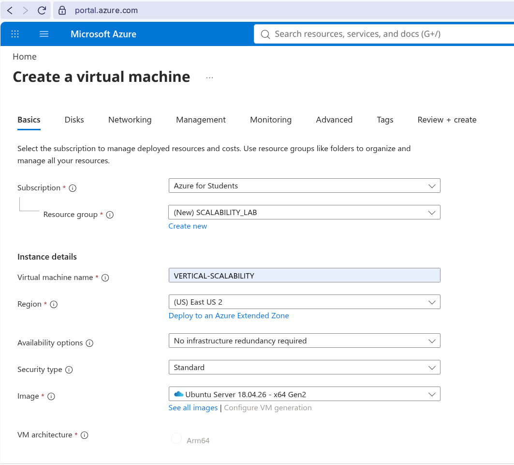

Aquí nos encontramos con el primer obstáculo: con la suscripción *Azure for Students* los tamaños `B1ls` y `B2ms` no estaban disponibles en la región, así que tuvimos que irnos por un `Standard_D2s_v3` (2 vCPUs, 8 GiB de RAM) y activar el descuento de *Azure Spot* para que el costo fuera mínimo (≈ 0.037 USD/hora). La política de desalojo quedó en *Stop / Deallocate*, para que si Azure necesita la capacidad simplemente apague la máquina sin borrarla.

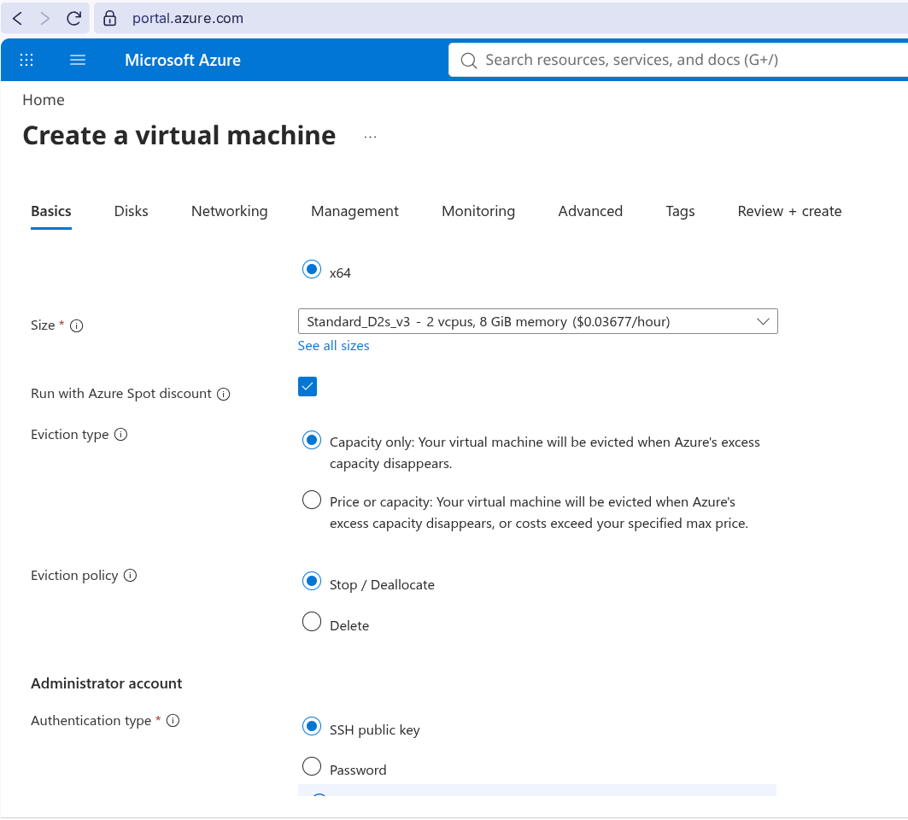

Para la autenticación usamos llave SSH. Dejamos que Azure generara el par de llaves (`VERTICAL-SCALABILITY_key`, formato RSA) con el usuario `scalability_lab`.

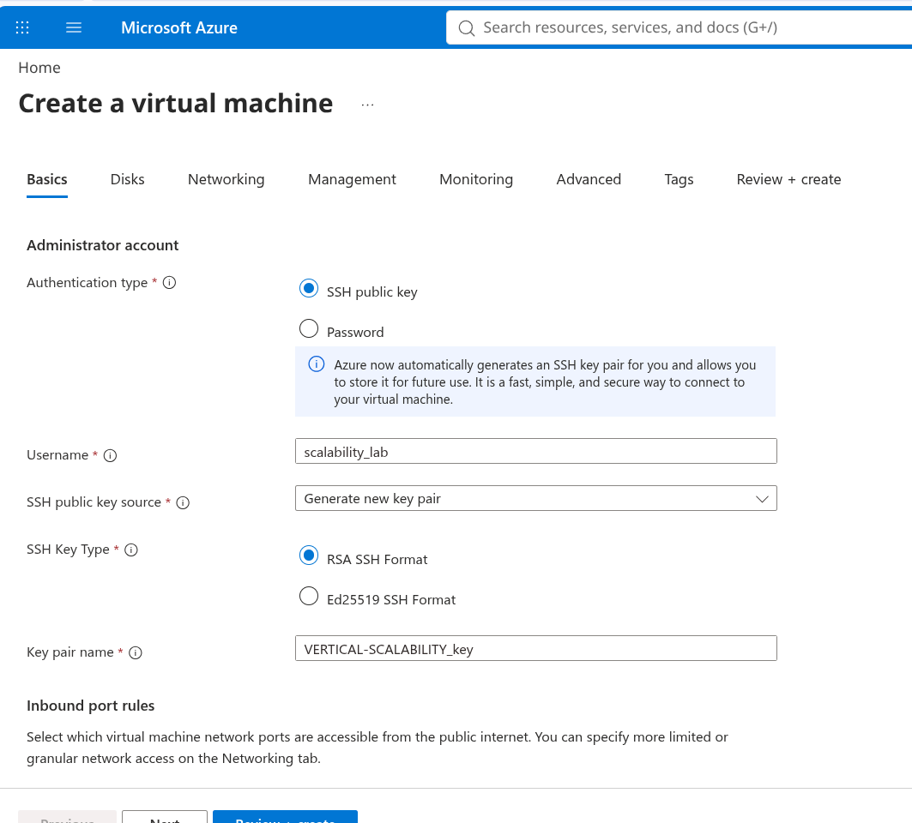

En los puertos de entrada habilitamos HTTP (80) y SSH (22). El puerto 3000, que es donde corre la aplicación, se abre más adelante con una regla aparte.

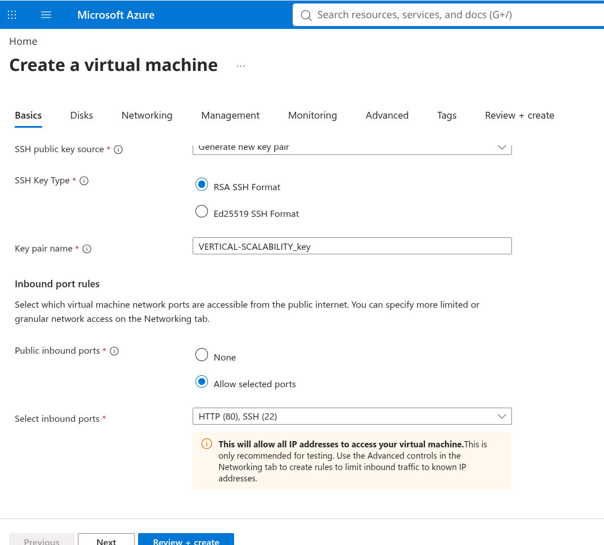

### 2. Conexión por SSH

Con la llave descargada nos conectamos a la IP pública de la VM (`20.44.100.48`):

```bash
ssh -i VERTICAL-SCALABILITY_key.pem scalability_lab@20.44.100.48
```

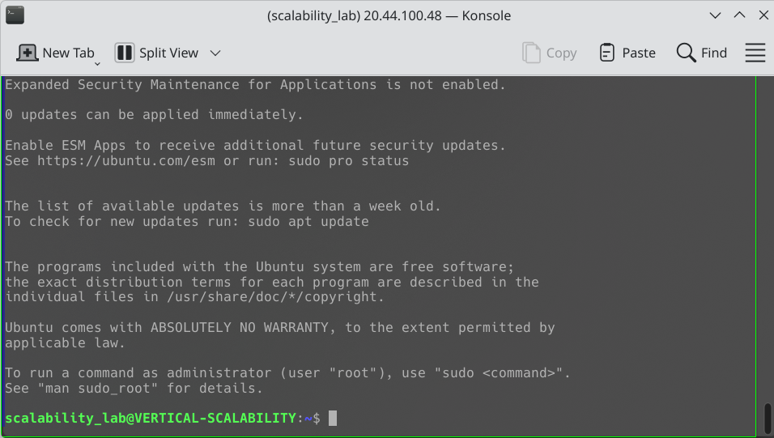

### 3 y 4. Instalación de Node y de la aplicación

Instalamos `nvm` y con él Node. Probamos primero la versión 8.10.0 que sugiere la guía, pero terminamos usando la LTS (v24.22.1), que funcionó sin problemas. Luego clonamos nuestro repositorio y ejecutamos `npm install` dentro de `FibonacciApp`.

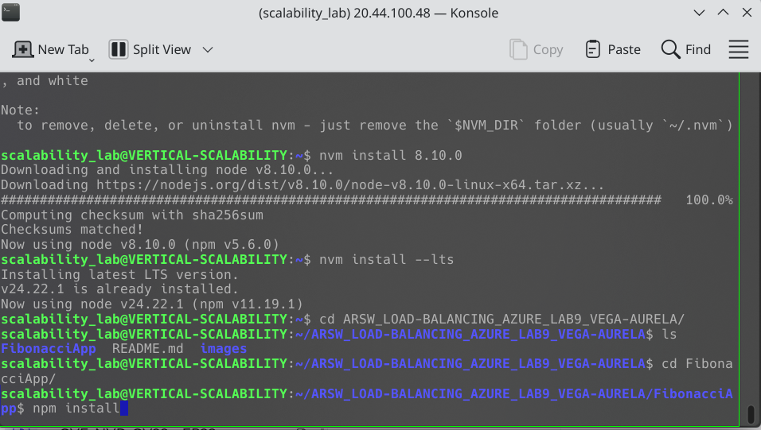

### 5 y 6. Ejecución y regla de entrada para el puerto 3000

Levantamos la app con `node FibonacciApp.js`, creamos en *Networking* la *Inbound port rule* para el puerto 3000 y probamos desde el navegador. La respuesta fue la esperada: `The answer is 8`.

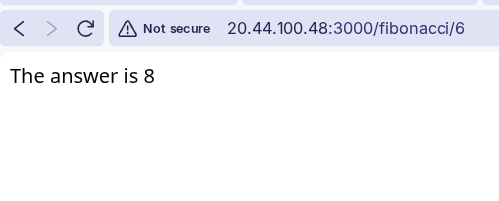

### 7. Tiempos de respuesta

Para no hacerlo petición por petición, escribimos un pequeño script en la consola del navegador que recorre los diez valores, mide cada llamada con `performance.now()` y al final imprime una tabla:

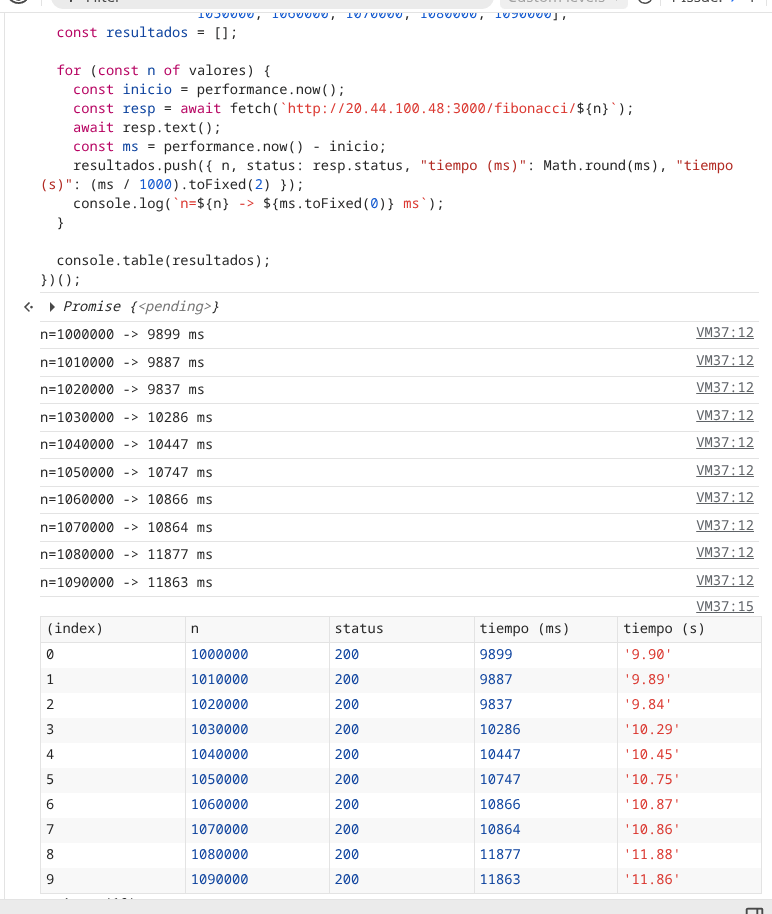

| n | Estado | Tiempo (ms) | Tiempo (s) |
|---|:---:|---:|---:|
| 1000000 | 200 | 9899 | 9.90 |
| 1010000 | 200 | 9887 | 9.89 |
| 1020000 | 200 | 9837 | 9.84 |
| 1030000 | 200 | 10286 | 10.29 |
| 1040000 | 200 | 10447 | 10.45 |
| 1050000 | 200 | 10747 | 10.75 |
| 1060000 | 200 | 10866 | 10.87 |
| 1070000 | 200 | 10864 | 10.86 |
| 1080000 | 200 | 11877 | 11.88 |
| 1090000 | 200 | 11863 | 11.86 |

Todas las peticiones respondieron bien, pero ninguna bajó de ~10 segundos, y el tiempo sube a medida que crece `n`.

### 8. Consumo de CPU

En la pestaña de métricas de la VM vimos el salto de CPU justo cuando empezaron las pruebas. En la primera captura se ve cómo la gráfica pasa de estar plana a un valor sostenido mientras se procesan las peticiones:

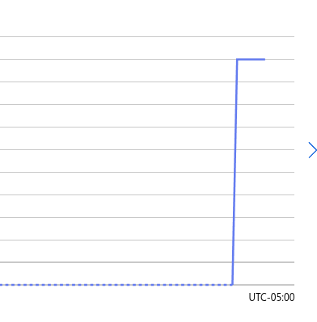

Y en la vista más amplia (promedio de *Percentage CPU*) se ve el pico llegando a ~17%, con un promedio en la ventana de 3.57%:

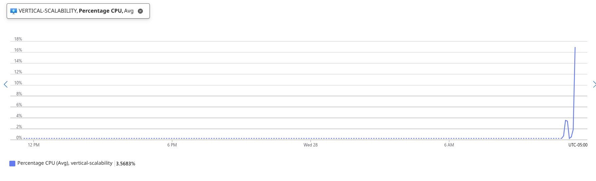

### 10. Intento de escalamiento vertical a B2ms

Al ir a la sección *Size* para cambiar a `B2ms`, Azure nos lo marcó como **Size not available** para nuestra suscripción y región (solo ofrecía la opción de pedir soporte). Lo curioso es que el tamaño en el que ya estábamos, `Standard_D2s_v3`, tiene prácticamente las mismas especificaciones que un `B2ms` (2 vCPUs, 8 GiB), así que en la práctica las pruebas ya se hicieron sobre una máquina equivalente al tamaño "escalado".

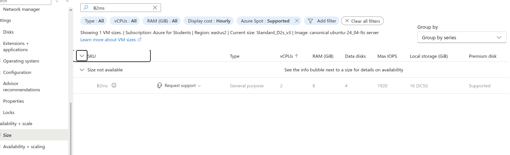

### 13. Limpieza y paso a la parte 2

Como no pudimos hacer el redimensionamiento, no hubo que devolver la VM a un tamaño menor. Seguimos con el mismo grupo de recursos `SCALABILITY_LAB` y empezamos a montar el balanceador de carga para la parte 2 (SKU *Standard*, tipo *Public*, región *Brazil South*):

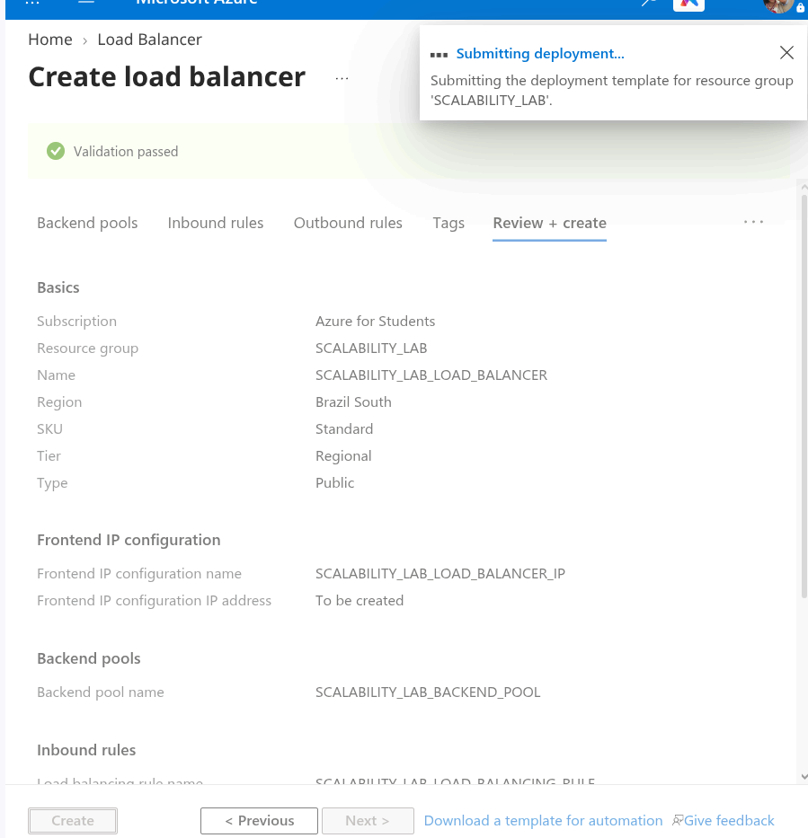

---

## Preguntas

### 1. ¿Cuántos y cuáles recursos crea Azure junto con la VM?

Además de la máquina virtual, Azure creó automáticamente **6 recursos más** dentro del grupo `SCALABILITY_LAB` (7 en total):

1. **Virtual machine** (`VERTICAL-SCALABILITY`)
2. **Disco del sistema operativo** (Managed Disk)
3. **Network Interface (NIC)**
4. **Public IP address**
5. **Network Security Group (NSG)**
6. **Virtual Network** (con su subnet por defecto)
7. **SSH key** (`VERTICAL-SCALABILITY_key`), porque elegimos que Azure generara el par de llaves

### 2. ¿Para qué sirve cada recurso?

- **Virtual machine:** es el cómputo en sí, la máquina donde corre Ubuntu y nuestra app.
- **Disco del SO:** almacenamiento persistente donde vive el sistema operativo y todo lo que instalamos (Node, el repo, etc.). Sobrevive a reinicios y desasignaciones.
- **Network Interface:** la "tarjeta de red" virtual que conecta la VM con la red virtual; a ella se le asocian la IP privada, la IP pública y el NSG.
- **Public IP:** la dirección por la que llegamos desde internet (por SSH y por el navegador).
- **Network Security Group:** es el firewall. Tiene las reglas que dicen qué tráfico entra y sale (22, 80 y luego el 3000).
- **Virtual Network / Subnet:** la red privada aislada dentro de Azure en la que vive la VM y desde la que puede comunicarse con otros recursos.
- **SSH key:** guarda la llave pública en Azure para poder reutilizarla en otras VMs; la privada es la que descargamos para conectarnos.

### 3. ¿Por qué se cae la app al cerrar SSH? ¿Por qué hace falta la Inbound port rule?

Cuando lanzamos `node FibonacciApp.js` desde la terminal, el proceso queda como hijo de la sesión SSH. Al cerrar la conexión, el sistema le manda la señal `SIGHUP` a todos los procesos de esa sesión y Node termina. Por eso se usan herramientas como `forever`, `pm2`, `nohup` o un servicio de `systemd`: desacoplan el proceso de la terminal y además lo reinician si falla.

La regla de entrada es necesaria porque el NSG, por defecto, bloquea todo el tráfico entrante que no esté explícitamente permitido. Al crear la VM solo abrimos el 22 y el 80; la app escucha en el 3000, así que sin esa regla las peticiones del navegador nunca llegan a la máquina aunque la app esté corriendo.

### 4. Tabla de tiempos e interpretación

La tabla está en el [punto 7](#7-tiempos-de-respuesta). Los tiempos van de ~9.9 s a ~11.9 s y crecen junto con `n`.

La razón está en cómo está hecho el algoritmo en `FibonacciService.js`:

- Es un ciclo que hace `n - 1` sumas, una por cada término. Para `n = 1.000.000` eso es un millón de iteraciones.
- Pero no son sumas de números normales: Fibonacci crece tan rápido que hay que usar `big-integer`. El número F(1.000.000) tiene alrededor de **209.000 dígitos**. Cada suma tiene que recorrer todos los dígitos, y esos dígitos van aumentando en cada iteración. En la práctica el costo total crece más o menos de forma cuadrática respecto a `n`.
- Encima, en cada iteración se crean objetos nuevos (los `bigInt` son inmutables), lo que pone a trabajar bastante al recolector de basura.
- Al final, `answer.toString()` convierte un número gigantesco a texto, que tampoco es gratis, y se manda una respuesta HTTP de ~200 KB.

Por eso un aumento de solo 1% en `n` se nota en el tiempo: cada iteración extra es más costosa que la anterior.

### 5. Consumo de CPU e interpretación

Las capturas están en el [punto 8](#8-consumo-de-cpu). La CPU pasa de casi 0% a un pico de ~17% mientras corren las peticiones.

A primera vista parece poco, pero hay que leerlo bien:

- Node.js ejecuta el JavaScript en **un solo hilo**. El cálculo de Fibonacci es 100% CPU y no tiene ningún `await` ni E/S que libere el hilo, así que mientras calcula ocupa un núcleo completo.
- La `D2s_v3` tiene 2 vCPUs, entonces una petición en curso, como mucho, puede llevar la máquina a ~50% de uso total, aunque el otro núcleo esté libre.
- Azure muestra un **promedio por intervalo** (por minuto o más, según el zoom). Como las peticiones fueron secuenciales y entre una y otra hay pequeñas pausas, el promedio aplana los picos. Por eso el valor promedio de la ventana sale en 3.57%.

En resumen: el consumo no es alto porque la máquina sobre, sino porque la app no es capaz de aprovechar más de un núcleo. Además, mientras está calculando, el *event loop* queda bloqueado y cualquier otra petición tiene que esperar en cola.

### 6. Resumen de la ejecución de Postman (newman)

> Nota: no alcanzamos a guardar la captura del resumen de `newman`, por eso aquí describimos lo que observamos; la evidencia de esa ejecución es el salto de CPU de la [imagen 9](images/9.png).

- **Tiempos de ejecución:** con dos `newman` corriendo en paralelo los tiempos por petición son bastante mayores que los ~10 s de la prueba secuencial. Como Node atiende una petición a la vez en un solo hilo, las peticiones de ambas corridas se ponen en cola y cada una termina esperando a que acaben las que llegaron antes; en la práctica el tiempo de respuesta se acerca al doble.
- **Fallos:** el riesgo principal son los *timeouts* o conexiones cerradas (`ESOCKETTIMEDOUT`/`ECONNRESET`) cuando la cola se vuelve demasiado larga. No es que la app lance un error, sino que el cliente se cansa de esperar porque el servidor está bloqueado calculando otra cosa.

### 7. Diferencia entre B2ms y B1ls

| | B1ls | B2ms |
|---|---|---|
| vCPUs | 1 | 2 |
| RAM | 0.5 GiB | 8 GiB |
| CPU base (sin créditos) | ~5% | ~60% (de 200%) |
| Pensada para | Servicios mínimos, pruebas, bastiones | Cargas generales con picos moderados |
| Costo aproximado | El más barato de Azure | Varias veces más caro |

Más allá de los números, las dos son de la **serie B (burstable)**: no entregan el 100% de la CPU todo el tiempo, sino un porcentaje base. Cuando la VM usa menos que esa base, acumula créditos; cuando los necesita, los gasta para subir al 100%. Si se acaban los créditos, la CPU queda limitada a la base.

Para nuestra app eso importa mucho: con `B1ls` la base es tan baja que con un par de cálculos de Fibonacci los créditos se agotan y la máquina queda ahogada. `B2ms` tiene una base mucho más alta y más créditos, así que aguanta más. Además, los 512 MB de la `B1ls` son muy justos para Node + un `bigInt` de 200 mil dígitos + el sistema operativo.

En nuestro caso terminamos usando `D2s_v3`, que tiene 2 vCPUs y 8 GiB como la `B2ms`, pero **no es burstable**: entrega el 100% de sus núcleos sin depender de créditos.

### 8. ¿Aumentar el tamaño de la VM es una buena solución? ¿Qué pasa con la app al cambiar el tamaño?

Ayuda un poco, pero no resuelve el problema de fondo. Un procesador más rápido o con más créditos hace que cada cálculo termine antes, pero la aplicación sigue usando **un solo núcleo**: pasar de 1 a 2 (o a 8) vCPUs no hace que una petición vaya más rápido, ni que se atiendan dos en paralelo. El cuello de botella está en el algoritmo y en el modelo de un solo hilo, no en la cantidad de hardware.

Y al cambiar el tamaño, Azure **reinicia la VM**. La app, que lanzamos a mano con `node`, se cae y no vuelve a levantarse sola; hay que entrar por SSH y arrancarla otra vez (o tenerla configurada con `forever`/`pm2`/`systemd` para que inicie con el sistema). Si la IP pública es dinámica, además puede cambiar.

### 9. ¿Qué pasa con la infraestructura al cambiar el tamaño? ¿Qué efectos negativos tiene?

Para redimensionar, Azure tiene que mover la VM a un host físico que tenga el nuevo tamaño disponible, así que la detiene, la reubica y la vuelve a encender. Los efectos negativos son:

- **Tiempo de inactividad:** durante el cambio el servicio no responde. Con una sola VM no hay nadie que atienda mientras tanto.
- **Pérdida de estado en memoria y del disco temporal**, si la VM tiene uno.
- **Posible cambio de IP pública** si no es estática.
- **Disponibilidad limitada de tamaños:** puede que el tamaño que queremos no exista en la región o en la suscripción. Eso fue exactamente lo que nos pasó con `B2ms` ([imagen 11](images/11.png)).
- **Techo de escalamiento:** siempre hay un tamaño máximo, y los más grandes son mucho más caros.
- **Punto único de falla:** seguimos dependiendo de una sola máquina.

### 10. ¿Hubo mejora en el consumo de CPU o en los tiempos de respuesta?

No pudimos medir un "antes y después" real porque el cambio a `B2ms` no estaba disponible y desde el principio trabajamos con una `D2s_v3`, que ya es equivalente en vCPUs y memoria.

Aun así, viendo cómo se comporta la app, la respuesta es que **no habría una mejora significativa en los tiempos de respuesta**. Cada petición se resuelve en un solo hilo, así que el segundo núcleo prácticamente no se usa (lo que explica el bajo porcentaje de CPU que vimos). Lo que sí cambiaría frente a una `B1ls` es que no nos quedaríamos sin créditos de CPU ni sin memoria, así que sería más estable y probablemente fallarían menos peticiones; pero cada una seguiría tardando unos 10 segundos.

### 11. Con 4 ejecuciones paralelas de Postman, ¿el comportamiento es porcentualmente mejor?

No. Al lanzar 4 `newman` en paralelo se duplica la concurrencia frente a la prueba con 2, pero la app sigue procesando una petición a la vez. Las peticiones se acumulan en cola, el tiempo de respuesta crece aproximadamente en proporción a la cantidad de clientes concurrentes y aumenta la probabilidad de *timeouts*. Porcentualmente, la tasa de éxito empeora o en el mejor de los casos se mantiene: el hardware adicional no se aprovecha.

---

## Conclusión sobre el escenario de calidad

El escenario pide que, con varios usuarios consultando valores de Fibonacci superiores a 1.000.000 de forma concurrente, **todas las peticiones se respondan y la CPU no pase del 70%**.

Con escalamiento vertical **no lo cumplimos**. Es cierto que la CPU nunca se acercó al 70%, pero eso no es una buena señal: significa que la app solo usa un núcleo y deja el resto ocioso. Lo que se ve afectado es la otra mitad del requerimiento: con carga concurrente las peticiones se encolan, los tiempos se disparan y aparecen *timeouts*. Hacer la máquina más grande no cambia esto, porque el límite lo pone el diseño de la aplicación (un hilo, algoritmo costoso) y no los recursos disponibles.

Además, el escalamiento vertical tiene sus propios problemas: requiere reiniciar la VM, depende de que el tamaño esté disponible (cosa que no pasó) y sigue siendo un único punto de falla. Por eso la parte 2 apunta a escalar horizontalmente: varias instancias detrás de un balanceador de carga, de forma que las peticiones concurrentes se repartan entre máquinas en lugar de hacer fila en una sola.
