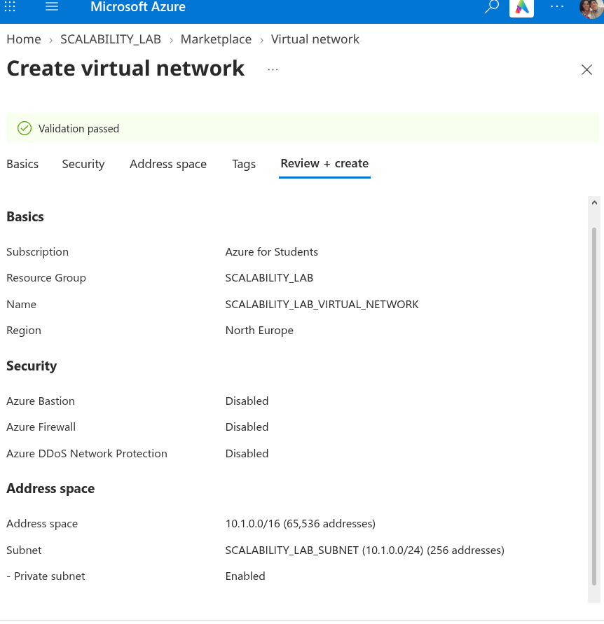
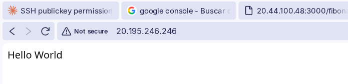
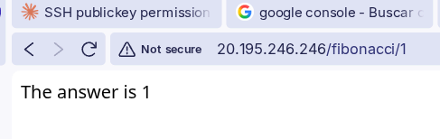
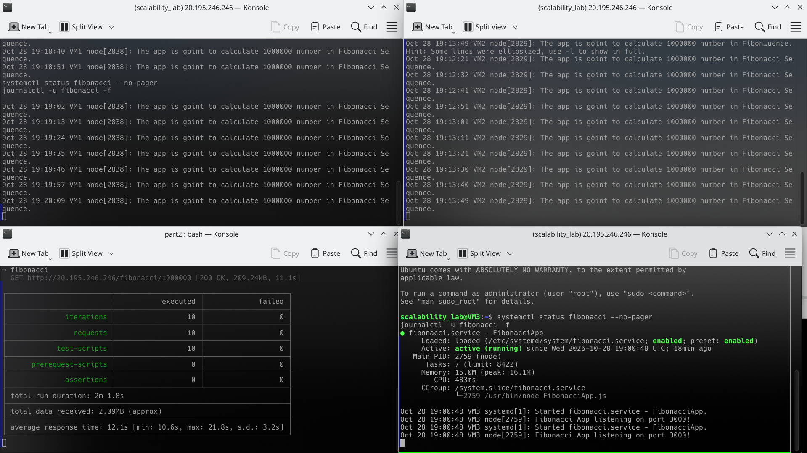
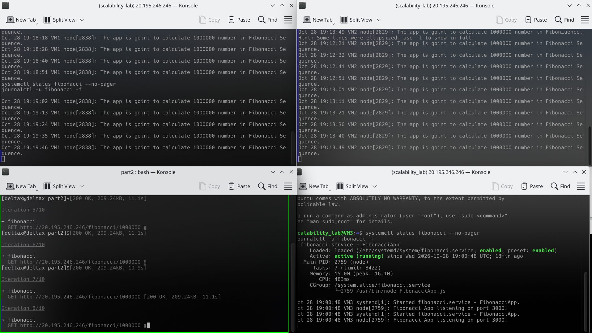
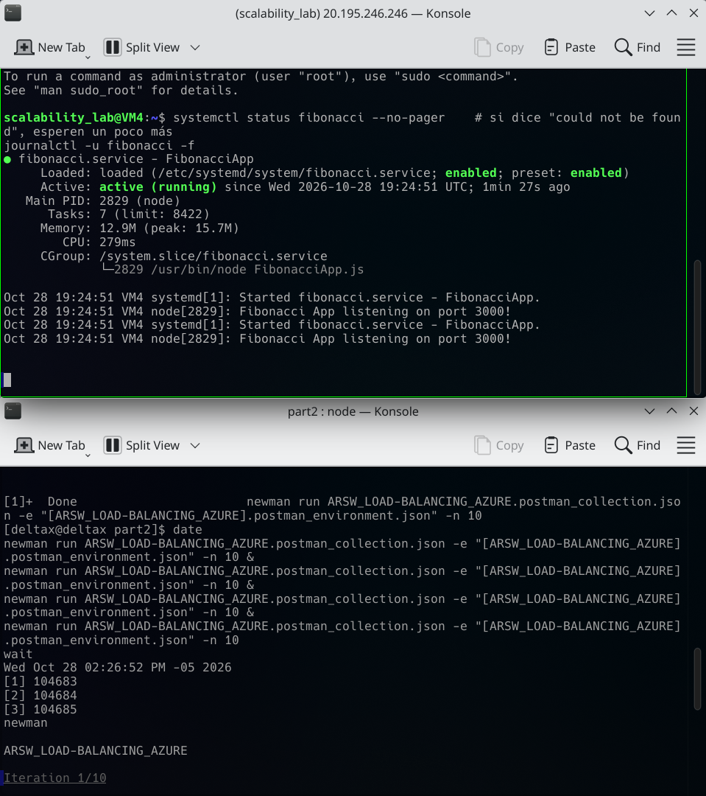
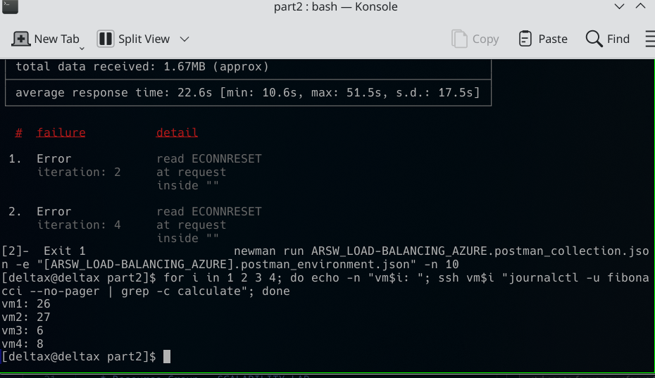
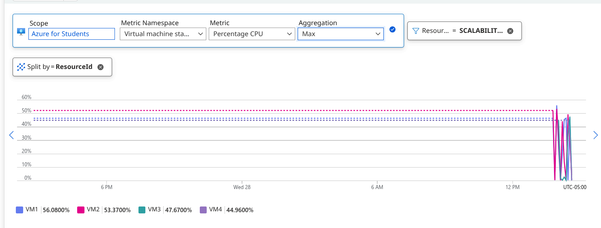
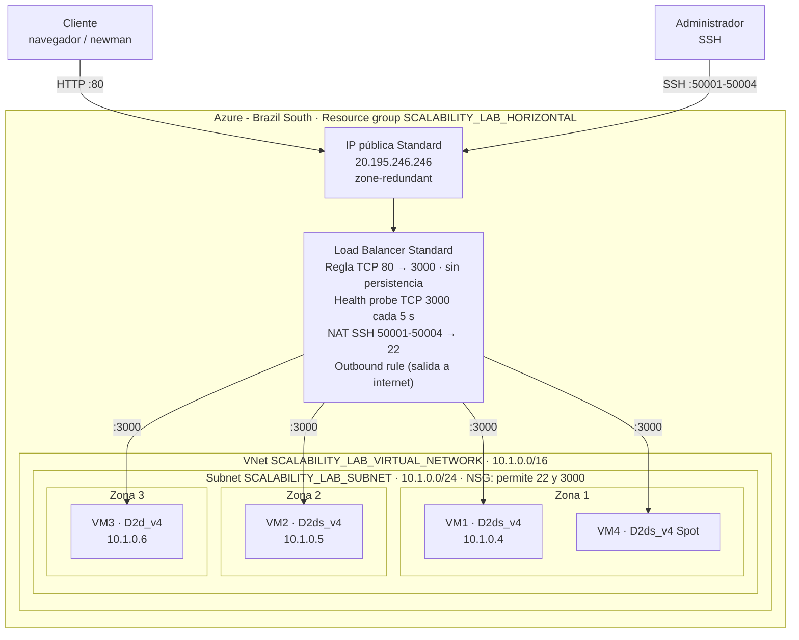

# Solución - Laboratorio 9: Escalamiento en Azure

### Escuela Colombiana de Ingeniería - Arquitecturas de Software (ARSW)

## Parte 1 - Escalabilidad vertical

### 1. Creación de la máquina virtual

Empezamos en el portal de Azure creando la VM. Dejamos el grupo de recursos `SCALABILITY_LAB` (nuevo), el nombre `VERTICAL-SCALABILITY`, región *East US 2* y una imagen de Ubuntu Server.


Aquí nos encontramos con el primer obstáculo: con la suscripción *Azure for Students* los tamaños `B1ls` y `B2ms` no estaban disponibles en la región, así que tuvimos que irnos por un `Standard_D2s_v3` (2 vCPUs, 8 GiB de RAM) y activar el descuento de *Azure Spot* para que el costo fuera mínimo (≈ 0.037 USD/hora). La política de desalojo quedó en *Stop / Deallocate*, para que si Azure necesita la capacidad simplemente apague la máquina sin borrarla.


Para la autenticación usamos llave SSH. Dejamos que Azure generara el par de llaves (`VERTICAL-SCALABILITY_key`, formato RSA) con el usuario `scalability_lab`.


En los puertos de entrada habilitamos HTTP (80) y SSH (22). El puerto 3000, que es donde corre la aplicación, se abre más adelante con una regla aparte.


### 2. Conexión por SSH

Con la llave descargada nos conectamos a la IP pública de la VM (`20.44.100.48`):

```bash
ssh -i VERTICAL-SCALABILITY_key.pem scalability_lab@20.44.100.48
```


### 3 y 4. Instalación de Node y de la aplicación

Instalamos `nvm` y con él Node. Probamos primero la versión 8.10.0 que sugiere la guía, pero terminamos usando la LTS (v24.22.1), que funcionó sin problemas. Luego clonamos nuestro repositorio y ejecutamos `npm install` dentro de `FibonacciApp`.


### 5 y 6. Ejecución y regla de entrada para el puerto 3000

Levantamos la app con `node FibonacciApp.js`, creamos en *Networking* la *Inbound port rule* para el puerto 3000 y probamos desde el navegador. La respuesta fue la esperada: `The answer is 8`.


### 7. Tiempos de respuesta

Para no hacerlo petición por petición, escribimos un pequeño script en la consola del navegador que recorre los diez valores, mide cada llamada con `performance.now()` y al final imprime una tabla:


| n | Estado | Tiempo (ms) | Tiempo (s) |
|---|:---:|---:|---:|
| 1000000 | 200 | 9899 | 9.90 |
| 1010000 | 200 | 9887 | 9.89 |
| 1020000 | 200 | 9837 | 9.84 |
| 1030000 | 200 | 10286 | 10.29 |
| 1040000 | 200 | 10447 | 10.45 |
| 1050000 | 200 | 10747 | 10.75 |
| 1060000 | 200 | 10866 | 10.87 |
| 1070000 | 200 | 10864 | 10.86 |
| 1080000 | 200 | 11877 | 11.88 |
| 1090000 | 200 | 11863 | 11.86 |

Todas las peticiones respondieron bien, pero ninguna bajó de ~10 segundos, y el tiempo sube a medida que crece `n`.

### 8. Consumo de CPU

En la pestaña de métricas de la VM vimos el salto de CPU justo cuando empezaron las pruebas. En la primera captura se ve cómo la gráfica pasa de estar plana a un valor sostenido mientras se procesan las peticiones:


Y en la vista más amplia (promedio de *Percentage CPU*) se ve el pico llegando a ~17%, con un promedio en la ventana de 3.57%:


### 10. Intento de escalamiento vertical a B2ms

Al ir a la sección *Size* para cambiar a `B2ms`, Azure nos lo marcó como **Size not available** para nuestra suscripción y región (solo ofrecía la opción de pedir soporte). Lo curioso es que el tamaño en el que ya estábamos, `Standard_D2s_v3`, tiene prácticamente las mismas especificaciones que un `B2ms` (2 vCPUs, 8 GiB), así que en la práctica las pruebas ya se hicieron sobre una máquina equivalente al tamaño "escalado".


### 13. Limpieza y paso a la parte 2

Como no pudimos hacer el redimensionamiento, no hubo que devolver la VM a un tamaño menor. Seguimos con el mismo grupo de recursos `SCALABILITY_LAB` y empezamos a montar el balanceador de carga para la parte 2 (SKU *Standard*, tipo *Public*, región *Brazil South*):


---

## Preguntas

### 1. ¿Cuántos y cuáles recursos crea Azure junto con la VM?

Además de la máquina virtual, Azure creó automáticamente **6 recursos más** dentro del grupo `SCALABILITY_LAB` (7 en total):

1. **Virtual machine** (`VERTICAL-SCALABILITY`)
2. **Disco del sistema operativo** (Managed Disk)
3. **Network Interface (NIC)**
4. **Public IP address**
5. **Network Security Group (NSG)**
6. **Virtual Network** (con su subnet por defecto)
7. **SSH key** (`VERTICAL-SCALABILITY_key`), porque elegimos que Azure generara el par de llaves

### 2. ¿Para qué sirve cada recurso?

- **Virtual machine:** es el cómputo en sí, la máquina donde corre Ubuntu y nuestra app.
- **Disco del SO:** almacenamiento persistente donde vive el sistema operativo y todo lo que instalamos (Node, el repo, etc.). Sobrevive a reinicios y desasignaciones.
- **Network Interface:** la "tarjeta de red" virtual que conecta la VM con la red virtual; a ella se le asocian la IP privada, la IP pública y el NSG.
- **Public IP:** la dirección por la que llegamos desde internet (por SSH y por el navegador).
- **Network Security Group:** es el firewall. Tiene las reglas que dicen qué tráfico entra y sale (22, 80 y luego el 3000).
- **Virtual Network / Subnet:** la red privada aislada dentro de Azure en la que vive la VM y desde la que puede comunicarse con otros recursos.
- **SSH key:** guarda la llave pública en Azure para poder reutilizarla en otras VMs; la privada es la que descargamos para conectarnos.

### 3. ¿Por qué se cae la app al cerrar SSH? ¿Por qué hace falta la Inbound port rule?

Cuando lanzamos `node FibonacciApp.js` desde la terminal, el proceso queda como hijo de la sesión SSH. Al cerrar la conexión, el sistema le manda la señal `SIGHUP` a todos los procesos de esa sesión y Node termina. Por eso se usan herramientas como `forever`, `pm2`, `nohup` o un servicio de `systemd`: desacoplan el proceso de la terminal y además lo reinician si falla.

La regla de entrada es necesaria porque el NSG, por defecto, bloquea todo el tráfico entrante que no esté explícitamente permitido. Al crear la VM solo abrimos el 22 y el 80; la app escucha en el 3000, así que sin esa regla las peticiones del navegador nunca llegan a la máquina aunque la app esté corriendo.

### 4. Tabla de tiempos e interpretación

La tabla está en el [punto 7](#7-tiempos-de-respuesta). Los tiempos van de ~9.9 s a ~11.9 s y crecen junto con `n`.

La razón está en cómo está hecho el algoritmo en `FibonacciService.js`:

- Es un ciclo que hace `n - 1` sumas, una por cada término. Para `n = 1.000.000` eso es un millón de iteraciones.
- Pero no son sumas de números normales: Fibonacci crece tan rápido que hay que usar `big-integer`. El número F(1.000.000) tiene alrededor de **209.000 dígitos**. Cada suma tiene que recorrer todos los dígitos, y esos dígitos van aumentando en cada iteración. En la práctica el costo total crece más o menos de forma cuadrática respecto a `n`.
- Encima, en cada iteración se crean objetos nuevos (los `bigInt` son inmutables), lo que pone a trabajar bastante al recolector de basura.
- Al final, `answer.toString()` convierte un número gigantesco a texto, que tampoco es gratis, y se manda una respuesta HTTP de ~200 KB.

Por eso un aumento de solo 1% en `n` se nota en el tiempo: cada iteración extra es más costosa que la anterior.

### 5. Consumo de CPU e interpretación

Las capturas están en el [punto 8](#8-consumo-de-cpu). La CPU pasa de casi 0% a un pico de ~17% mientras corren las peticiones.

A primera vista parece poco, pero hay que leerlo bien:

- Node.js ejecuta el JavaScript en **un solo hilo**. El cálculo de Fibonacci es 100% CPU y no tiene ningún `await` ni E/S que libere el hilo, así que mientras calcula ocupa un núcleo completo.
- La `D2s_v3` tiene 2 vCPUs, entonces una petición en curso, como mucho, puede llevar la máquina a ~50% de uso total, aunque el otro núcleo esté libre.
- Azure muestra un **promedio por intervalo** (por minuto o más, según el zoom). Como las peticiones fueron secuenciales y entre una y otra hay pequeñas pausas, el promedio aplana los picos. Por eso el valor promedio de la ventana sale en 3.57%.

En resumen: el consumo no es alto porque la máquina sobre, sino porque la app no es capaz de aprovechar más de un núcleo. Además, mientras está calculando, el *event loop* queda bloqueado y cualquier otra petición tiene que esperar en cola.

### 6. Resumen de la ejecución de Postman (newman)

> Nota: no alcanzamos a guardar la captura del resumen de `newman`, por eso aquí describimos lo que observamos; la evidencia de esa ejecución es el salto de CPU de la [imagen 9](images/9.png).

- **Tiempos de ejecución:** con dos `newman` corriendo en paralelo los tiempos por petición son bastante mayores que los ~10 s de la prueba secuencial. Como Node atiende una petición a la vez en un solo hilo, las peticiones de ambas corridas se ponen en cola y cada una termina esperando a que acaben las que llegaron antes; en la práctica el tiempo de respuesta se acerca al doble.
- **Fallos:** el riesgo principal son los *timeouts* o conexiones cerradas (`ESOCKETTIMEDOUT`/`ECONNRESET`) cuando la cola se vuelve demasiado larga. No es que la app lance un error, sino que el cliente se cansa de esperar porque el servidor está bloqueado calculando otra cosa.

### 7. Diferencia entre B2ms y B1ls

| | B1ls | B2ms |
|---|---|---|
| vCPUs | 1 | 2 |
| RAM | 0.5 GiB | 8 GiB |
| CPU base (sin créditos) | ~5% | ~60% (de 200%) |
| Pensada para | Servicios mínimos, pruebas, bastiones | Cargas generales con picos moderados |
| Costo aproximado | El más barato de Azure | Varias veces más caro |

Más allá de los números, las dos son de la **serie B (burstable)**: no entregan el 100% de la CPU todo el tiempo, sino un porcentaje base. Cuando la VM usa menos que esa base, acumula créditos; cuando los necesita, los gasta para subir al 100%. Si se acaban los créditos, la CPU queda limitada a la base.

Para nuestra app eso importa mucho: con `B1ls` la base es tan baja que con un par de cálculos de Fibonacci los créditos se agotan y la máquina queda ahogada. `B2ms` tiene una base mucho más alta y más créditos, así que aguanta más. Además, los 512 MB de la `B1ls` son muy justos para Node + un `bigInt` de 200 mil dígitos + el sistema operativo.

En nuestro caso terminamos usando `D2s_v3`, que tiene 2 vCPUs y 8 GiB como la `B2ms`, pero **no es burstable**: entrega el 100% de sus núcleos sin depender de créditos.

### 8. ¿Aumentar el tamaño de la VM es una buena solución? ¿Qué pasa con la app al cambiar el tamaño?

Ayuda un poco, pero no resuelve el problema de fondo. Un procesador más rápido o con más créditos hace que cada cálculo termine antes, pero la aplicación sigue usando **un solo núcleo**: pasar de 1 a 2 (o a 8) vCPUs no hace que una petición vaya más rápido, ni que se atiendan dos en paralelo. El cuello de botella está en el algoritmo y en el modelo de un solo hilo, no en la cantidad de hardware.

Y al cambiar el tamaño, Azure **reinicia la VM**. La app, que lanzamos a mano con `node`, se cae y no vuelve a levantarse sola; hay que entrar por SSH y arrancarla otra vez (o tenerla configurada con `forever`/`pm2`/`systemd` para que inicie con el sistema). Si la IP pública es dinámica, además puede cambiar.

### 9. ¿Qué pasa con la infraestructura al cambiar el tamaño? ¿Qué efectos negativos tiene?

Para redimensionar, Azure tiene que mover la VM a un host físico que tenga el nuevo tamaño disponible, así que la detiene, la reubica y la vuelve a encender. Los efectos negativos son:

- **Tiempo de inactividad:** durante el cambio el servicio no responde. Con una sola VM no hay nadie que atienda mientras tanto.
- **Pérdida de estado en memoria y del disco temporal**, si la VM tiene uno.
- **Posible cambio de IP pública** si no es estática.
- **Disponibilidad limitada de tamaños:** puede que el tamaño que queremos no exista en la región o en la suscripción. Eso fue exactamente lo que nos pasó con `B2ms` ([imagen 11](images/11.png)).
- **Techo de escalamiento:** siempre hay un tamaño máximo, y los más grandes son mucho más caros.
- **Punto único de falla:** seguimos dependiendo de una sola máquina.

### 10. ¿Hubo mejora en el consumo de CPU o en los tiempos de respuesta?

No pudimos medir un "antes y después" real porque el cambio a `B2ms` no estaba disponible y desde el principio trabajamos con una `D2s_v3`, que ya es equivalente en vCPUs y memoria.

Aun así, viendo cómo se comporta la app, la respuesta es que **no habría una mejora significativa en los tiempos de respuesta**. Cada petición se resuelve en un solo hilo, así que el segundo núcleo prácticamente no se usa (lo que explica el bajo porcentaje de CPU que vimos). Lo que sí cambiaría frente a una `B1ls` es que no nos quedaríamos sin créditos de CPU ni sin memoria, así que sería más estable y probablemente fallarían menos peticiones; pero cada una seguiría tardando unos 10 segundos.

### 11. Con 4 ejecuciones paralelas de Postman, ¿el comportamiento es porcentualmente mejor?

No. Al lanzar 4 `newman` en paralelo se duplica la concurrencia frente a la prueba con 2, pero la app sigue procesando una petición a la vez. Las peticiones se acumulan en cola, el tiempo de respuesta crece aproximadamente en proporción a la cantidad de clientes concurrentes y aumenta la probabilidad de *timeouts*. Porcentualmente, la tasa de éxito empeora o en el mejor de los casos se mantiene: el hardware adicional no se aprovecha.

---

## Conclusión sobre el escenario de calidad

El escenario pide que, con varios usuarios consultando valores de Fibonacci superiores a 1.000.000 de forma concurrente, **todas las peticiones se respondan y la CPU no pase del 70%**.

Con escalamiento vertical **no lo cumplimos**. Es cierto que la CPU nunca se acercó al 70%, pero eso no es una buena señal: significa que la app solo usa un núcleo y deja el resto ocioso. Lo que se ve afectado es la otra mitad del requerimiento: con carga concurrente las peticiones se encolan, los tiempos se disparan y aparecen *timeouts*. Hacer la máquina más grande no cambia esto, porque el límite lo pone el diseño de la aplicación (un hilo, algoritmo costoso) y no los recursos disponibles.

Además, el escalamiento vertical tiene sus propios problemas: requiere reiniciar la VM, depende de que el tamaño esté disponible (cosa que no pasó) y sigue siendo un único punto de falla. Por eso la parte 2 apunta a escalar horizontalmente: varias instancias detrás de un balanceador de carga, de forma que las peticiones concurrentes se repartan entre máquinas en lugar de hacer fila en una sola.

---

## Parte 2 - Escalabilidad horizontal

### Cómo armamos la infraestructura (y por qué no salió igual que en la guía)

Arrancamos por el portal, como muestra la guía. Creamos el balanceador en *Brazil South* (ver la [imagen 12](images/12.png)) y también la red virtual con su subnet. La primera red la hicimos en *North Europe* siguiendo la imagen del enunciado:



Al pasar a crear las máquinas nos topamos con los límites de la suscripción *Azure for Students*, y tuvimos que cambiar varias cosas:

| Límite que encontramos | Qué hicimos |
|---|---|
| Casi todos los tamaños pequeños (serie B, A1_v2, D2s_v3, D2as_v5…) salen como `NotAvailableForSubscription` en Brazil South | Buscar qué tamaños sí estaban habilitados; quedaron los `D2ds_v4` y `D2d_v4` (2 vCPU, 8 GiB) |
| Cuota de **6 vCPUs** normales por región y **4 por familia** de tamaño | VM1 y VM2 en `D2ds_v4`, VM3 en `D2d_v4` (otra familia) y VM4 como **Spot**, que tiene una cuota aparte de 3 vCPUs |
| Solo **3 IPs públicas** por región | Las VMs no tienen IP pública propia: salen a internet con una *outbound rule* del balanceador y entramos por SSH con *inbound NAT rules* (puertos 50001-50004) |
| Las subnets nuevas son privadas por defecto (en la imagen anterior se ve *Private subnet: Enabled*) | La misma *outbound rule* les da salida a internet para instalar Node y clonar el repo |

Hacer todo esto a mano, VM por VM, era lento y propenso a errores. Por eso lo automatizamos con el script [parte2-azure.sh](parte2-azure.sh), que corre en Azure Cloud Shell. Esa es justamente la idea que menciona el enunciado sobre herramientas para automatizar el aprovisionamiento. El script:

1. Crea el grupo `SCALABILITY_LAB_HORIZONTAL`, la VNet `10.1.0.0/16`, la subnet `10.1.0.0/24` y el NSG con los puertos 22 y 3000 abiertos.
2. Crea el balanceador **Standard** público con:
   - *Backend pool* `SCALABILITY_LAB_BACKEND_POOL`.
   - *Health probe* TCP al puerto 3000 cada 5 s.
   - *Load balancing rule* 80 → 3000 sin persistencia de sesión.
   - *Outbound rule*.
3. Crea cada VM en una zona distinta con Ubuntu 24.04. Revisa la cuota antes de cada una y, si un tamaño no cabe, prueba con el siguiente.
4. Instala la app de forma automática con *cloud-init*: Node 22 LTS, `git clone` del repo, `npm install` y la app registrada como servicio de `systemd`. Usamos `systemd` en lugar de `forever` para que la app vuelva a arrancar sola si la VM se reinicia (o si Azure desaloja la VM Spot).

La infraestructura final quedó así:

| VM | Zona | Tamaño | Prioridad | IP privada |
|---|:---:|---|---|---|
| VM1 | 1 | Standard_D2ds_v4 | Normal | 10.1.0.4 |
| VM2 | 2 | Standard_D2ds_v4 | Normal | 10.1.0.5 |
| VM3 | 3 | Standard_D2d_v4 | Normal | 10.1.0.6 |
| VM4 | 1 | Standard_D2ds_v4 | Spot | — |

Brazil South solo tiene 3 zonas de disponibilidad, por eso VM4 quedó otra vez en la zona 1.

### Probar el resultado final

La IP pública del balanceador quedó en `20.195.246.246`. Los dos endpoints básicos respondieron bien a través de él:





### Prueba con newman: 3 VMs y 2 ejecuciones en paralelo (punto 2)

Corrimos las dos ejecuciones de newman desde nuestro PC. Al mismo tiempo dejamos abierto `journalctl -u fibonacci -f` en cada VM para ver en vivo a cuál le llegaba cada petición:





Lo que se ve en las capturas:

- **Ejecución sin errores:** 10 de 10 peticiones exitosas, con un tiempo promedio de **12.1 s** (mínimo 10.6 s, máximo 21.8 s, desviación de 3.2 s) y una duración total de 2 min 1.8 s.
- **La otra ejecución:** tuvo un fallo `read ECONNRESET` en la iteración 3. El resto respondió `200 OK` en unos 11 s.
- **Cómo se repartió la carga:** en los logs, cada cliente de newman quedó pegado a una sola VM. Las peticiones de uno llegaron todas a VM2 (19:12-19:13) y las del otro a VM1 (19:18-19:20), espaciadas unos 10-11 s, o sea una tras otra. VM3 casi no recibió trabajo en esta prueba: su servicio llevaba apenas 483 ms de CPU.

**¿Por qué pasa esto?** Azure Load Balancer trabaja en la capa 4: reparte **conexiones TCP**, no peticiones HTTP, y elige la VM con un hash de 5 valores (IP y puerto de origen, IP y puerto de destino, protocolo). Newman reutiliza la misma conexión (*keep-alive*) para todas sus iteraciones, así que todas las peticiones de un mismo cliente terminan en la misma VM.

**¿Y el `ECONNRESET`?** Aparece cuando dos clientes caen en la misma VM. Node atiende una petición a la vez, y mientras calcula Fibonacci(1.000.000), unos 11 s, el *event loop* queda bloqueado. La conexión del otro cliente supera los 5 s de *keep-alive* que Node tiene por defecto. Cuando el event loop se libera, Node cierra esa conexión justo cuando newman acababa de mandar su siguiente petición. Es el mismo cuello de botella de la parte 1, solo que ahora ocurre únicamente cuando dos clientes coinciden en la misma máquina.

### Prueba con newman: 4 VMs y 4 ejecuciones en paralelo (punto 3)

Agregamos VM4 (Spot, zona 1). Cuando el servicio quedó activo, lanzamos las 4 ejecuciones de newman al tiempo:



Al terminar, contamos en el log de cada VM cuántos cálculos atendió en total, sumando todas las pruebas de la parte 2:



| VM | Peticiones atendidas (acumulado) |
|---|---:|
| VM1 | 26 |
| VM2 | 27 |
| VM3 | 6 |
| VM4 | 8 |

La ejecución cuyo resumen quedó en la captura tuvo **2 fallos `ECONNRESET`** (iteraciones 2 y 4), un promedio de **22.6 s** (mínimo 10.6 s, máximo 51.5 s, desviación de 17.5 s) y recibió 1.67 MB, es decir unas 8 respuestas completas de 209 KB.

#### Comportamiento de la CPU de las 4 VMs

En *Azure Monitor → Metrics* graficamos la métrica **Percentage CPU** con agregación **Max**, filtrada al grupo de recursos y separada por VM:



| VM | CPU máxima | Peticiones atendidas |
|---|---:|---:|
| VM1 | 56.08% | 26 |
| VM2 | 53.37% | 27 |
| VM3 | 47.67% | 6 |
| VM4 | 44.96% | 8 |

Lo que se ve en la gráfica:

- **Todas las VMs llegan a un pico parecido, entre 45% y 56%, sin importar cuántas peticiones atendieron.** Mientras calcula un Fibonacci, una VM tiene **un núcleo al 100% y el otro casi libre**: son `D2` de 2 vCPUs y Node usa un solo hilo. Por eso el máximo ronda la mitad. Lo poco que pasa del 50% en VM1 y VM2 son el sistema operativo, el recolector de basura de Node y el tráfico de red ocupando un poco del segundo núcleo.
- **La diferencia entre VMs no está en el pico, sino en cuánto tiempo estuvieron ocupadas.** VM1 y VM2, con 26-27 peticiones, se mantuvieron arriba casi toda la prueba. VM3 y VM4, con 6-8 peticiones, solo tuvieron picos cortos y luego bajaron a ~0%. Eso confirma el reparto desigual que vimos en los logs.
- **Ninguna VM superó el 70%** que pide el escenario de calidad. Pero esto no significa que sobre capacidad: como en la parte 1, la app no puede aprovechar el segundo núcleo, así que la mitad de la CPU contratada se queda sin usar.

#### ¿Por qué la tasa de éxito mejora con este estilo de escalabilidad?

Con escalamiento vertical, todos los clientes concurrentes caen en **el mismo proceso de Node**. Las peticiones hacen fila detrás de cálculos de 10 s y, mientras más clientes hay, más conexiones se cierran o se vencen esperando. Con escalamiento horizontal cada VM tiene **su propio event loop**: si cada cliente cae en una VM diferente, todos se atienden en paralelo, sin fila, y responden en los ~11 s que tarda un cálculo. Agregar máquinas multiplica la cantidad de peticiones que se pueden atender al mismo tiempo, algo que una VM más grande no logra con esta app.

En nuestras pruebas la mejora no fue perfecta por cómo reparte el balanceador. Con 4 clientes y 4 VMs, el hash hizo que varios clientes coincidieran en la misma máquina: VM1 y VM2 se llevaron casi todo y VM3 y VM4 muy poco. Ahí reaparecen la fila (el máximo de 51.5 s equivale a unas 4-5 peticiones esperando) y los `ECONNRESET`. Aun así, la mayoría de las peticiones se respondieron, y los clientes que quedaron solos en una VM tuvieron tiempos estables de ~11 s.

Para repartir mejor convendría:
- usar un balanceador de capa 7 (Application Gateway), que reparte **por petición** y no por conexión;
- desactivar el *keep-alive* en los clientes;
- correr la app en modo *cluster* de Node para usar los 2 núcleos de cada VM.

### Informe comparativo: vertical vs. horizontal

| Aspecto | Vertical (parte 1) | Horizontal (parte 2) |
|---|---|---|
| Infraestructura | 1 VM `D2s_v3` Spot (2 vCPU, 8 GiB) en East US 2 | 4 VMs `D2ds_v4`/`D2d_v4` (2 vCPU, 8 GiB) en 3 zonas + Load Balancer Standard |
| Tiempo por petición sin competencia | 9.8 s – 11.9 s | 10.6 s – 11.1 s |
| 2 clientes concurrentes | Comparten un solo event loop: cada petición espera a la del otro, unos 20 s | Promedio de 12.1 s cuando cada cliente cae en una VM distinta; 1 fallo cuando coinciden |
| 4 clientes concurrentes | Toda la fila en un solo proceso: se esperan tiempos de unos 40 s y más fallos | Promedio de 22.6 s y 2 fallos en la ejecución medida, por clientes que coincidieron en la misma VM |
| Tolerancia a fallos | Punto único de falla; cambiar el tamaño exige reiniciar | Si una VM o una zona cae, el health probe la saca y las demás siguen atendiendo |
| Escalar más | Limitado al tamaño más grande disponible (y `B2ms` ni siquiera estaba habilitado) | Basta con agregar VMs al backend pool, sin apagar las que ya están |

#### Costos por hora (precios públicos de Azure, Linux, pago por uso)

| Recurso | Vertical | Horizontal |
|---|---:|---:|
| VMs | 1 × D2s_v3 Spot (East US 2) = **$0.037** | 3 × D2ds_v4/D2d_v4 ($0.18) + 1 × D2ds_v4 Spot ($0.033) = **$0.573** |
| IP pública Standard | $0.005 | $0.005 (solo la del balanceador) |
| Load Balancer Standard (hasta 5 reglas) | — | ~$0.025 + $0.005 por GB procesado |
| **Total aproximado por hora** | **≈ $0.042** | **≈ $0.60** |
| **Total aproximado al mes (730 h)** | **≈ $31** | **≈ $440** |

Los precios de las VMs y de la IP salen de la API pública de precios de Azure (`prices.azure.com`), consultada el 28/10/2026. El del balanceador es la tarifa de referencia de la página de precios de Azure.

La diferencia es enorme. Una parte viene de que en la parte 1 usamos Spot, que es mucho más barato. Otra parte viene de que Brazil South es una región cara: el mismo `D2ds_v4` cuesta $0.113/h en East US 2 y $0.18/h en Brazil South. Si la VM vertical hubiera sido normal (sin Spot), costaría $0.096/h, unos $70 al mes. Aun así, la horizontal sale **unas 6 veces más cara**.

Ese costo extra paga dos cosas que la vertical no ofrece: atender varios clientes realmente en paralelo y sobrevivir a la caída de una máquina o de una zona entera. Para esta aplicación en particular, la solución más barata sería corregir el algoritmo y usar los dos núcleos de cada VM. Con eso se necesitarían menos máquinas.

---

## Preguntas de la parte 2

### ¿Cuáles son los tipos de balanceadores de carga en Azure y en qué se diferencian?

Azure tiene varios servicios de balanceo. Se diferencian por la capa del modelo OSI en la que trabajan y por si son regionales o globales:

| Servicio | Capa | Alcance | Para qué sirve |
|---|---|---|---|
| **Azure Load Balancer** | 4 (TCP/UDP) | Regional | Repartir conexiones entre VMs; muy rápido y sin entender HTTP. Es el que usamos |
| **Application Gateway** | 7 (HTTP/HTTPS) | Regional | Balanceo por petición, enrutamiento por URL o host, terminación TLS y firewall web (WAF) |
| **Azure Front Door** | 7 | Global | Puerta de entrada global con CDN, aceleración y WAF para apps en varias regiones |
| **Traffic Manager** | DNS | Global | Redirige a los usuarios a la región más cercana o disponible mediante respuestas DNS |
| **Gateway Load Balancer** | 3/4 | Regional | Insertar dispositivos virtuales de red (firewalls, inspección) de forma transparente |

Además, el Azure Load Balancer puede ser **público**, que recibe tráfico de internet con una IP pública, o **interno**, que balancea dentro de la VNet con una IP privada.

### ¿Qué es SKU, qué tipos hay y en qué se diferencian?

El **SKU** (*Stock Keeping Unit*) es la "edición" o nivel de un recurso. Define sus capacidades, sus límites, su SLA y su precio. Para el Load Balancer existen:

- **Basic:** era gratis, admitía hasta 300 instancias, no tenía SLA ni soporte de zonas de disponibilidad y estaba abierto por defecto. **Azure lo retiró el 30 de septiembre de 2025**, junto con las IPs públicas Basic, así que hoy ya no es una opción.
- **Standard:** el actual. Admite hasta 1000 instancias, tiene SLA del 99.99%, soporta zonas (zonal o con redundancia de zona), *outbound rules* y health probes HTTPS, y es **seguro por defecto**: no deja pasar tráfico si un NSG no lo permite. Se cobra por reglas y por datos procesados.
- **Gateway:** pensado para encadenar dispositivos virtuales de red, no para balancear una aplicación.

El concepto de SKU también se usa en otros recursos. Las IPs públicas, por ejemplo, tienen SKU Standard o Global, y los tamaños de VM (`Standard_D2ds_v4`) también son SKUs.

### ¿Por qué el balanceador de carga necesita una IP pública?

Porque es la **única puerta de entrada** al sistema desde internet. Los usuarios no conocen ni deben conocer las VMs individuales: le hablan a una sola dirección, `20.195.246.246`, y el balanceador decide qué VM atiende cada conexión. Así se pueden agregar, quitar o reemplazar VMs sin que el cliente se entere.

En nuestro caso la IP pública cumplió además otros dos papeles:
- **Salida a internet de las VMs** (SNAT con la *outbound rule*), porque ellas no tienen IP propia.
- **Entrada por SSH** a cada VM mediante las reglas NAT.

### ¿Cuál es el propósito del *Backend Pool*?

Es el **grupo de máquinas** que van a recibir el tráfico del balanceador; en nuestro caso, las NICs de VM1 a VM4. La regla de balanceo apunta al pool y no a VMs concretas, así que escalar horizontalmente es tan simple como meter una VM más al pool. Eso fue lo que hicimos con VM4, sin tocar la configuración del balanceador ni interrumpir a las demás.

### ¿Cuál es el propósito del *Health Probe*?

Revisar periódicamente si cada VM del pool está en condiciones de recibir tráfico. Configuramos una sonda TCP al puerto 3000 cada 5 segundos: si la VM acepta la conexión, se considera sana. Si deja de responder (se cayó la app, se reinició la VM o Azure desalojó la VM Spot), el balanceador **deja de mandarle tráfico** hasta que se recupere.

Sin el probe, el balanceador seguiría enviando usuarios a una máquina muerta. Una sonda **HTTP** a una ruta como `/` sería todavía más precisa, porque comprobaría que la aplicación responde y no solo que el puerto está abierto.

### ¿Cuál es el propósito de la *Load Balancing Rule*?

Define **cómo** se reparte el tráfico. Indica:
- qué IP y puerto del frontend escuchar (80);
- a qué puerto del backend reenviar (3000);
- con qué protocolo (TCP);
- a qué backend pool;
- con qué health probe se decide qué VMs están sanas;
- qué tipo de persistencia de sesión usar.

Gracias a esta regla el usuario entra por el puerto 80 estándar sin saber que la app corre en el 3000.

### ¿Qué tipos de sesión persistente existen, por qué es importante y cómo afecta la escalabilidad?

La persistencia (*session persistence* o *affinity*) decide si las peticiones de un mismo cliente deben ir siempre a la misma VM. En Azure Load Balancer hay tres modos:

| Modo | Hash usado | Comportamiento |
|---|---|---|
| **None** (por defecto) | 5-tupla: IP origen, puerto origen, IP destino, puerto destino, protocolo | Cada conexión nueva puede caer en cualquier VM |
| **Client IP** | 2-tupla: IP origen, IP destino | Todas las conexiones de una misma IP van a la misma VM |
| **Client IP and protocol** | 3-tupla: IP origen, IP destino, protocolo | Igual que la anterior, pero separando por protocolo |

**Por qué es importante:** si la aplicación guarda estado en memoria (una sesión de usuario, un carrito de compras), el cliente tiene que volver a la misma VM o perdería ese estado.

**Cómo afecta la escalabilidad:** mientras más "pegajosa" es la persistencia, **peor se reparte la carga**. Si muchos usuarios salen por la misma IP (una universidad, una empresa detrás de un NAT), con *Client IP* todos caerían en la misma VM mientras las demás quedan ociosas. Además, al agregar VMs nuevas, los clientes existentes no se redistribuyen.

Lo vimos en nuestras pruebas incluso con *None*. Como newman reutiliza la misma conexión TCP, cada cliente quedó pegado a una VM y la carga terminó desbalanceada (VM1 y VM2 con 26-27 peticiones, VM3 y VM4 con 6-8). Lo ideal para escalar es que la aplicación **no guarde estado** (*stateless*) y que el estado viva en un servicio externo, como una base de datos o Redis. Así se puede usar *None* y el balanceador reparte libremente.

### ¿Qué es una *Virtual Network*? ¿Qué es una *Subnet*? ¿Para qué sirven el *address space* y el *address range*?

- **Virtual Network (VNet):** es una red privada y aislada dentro de Azure, el equivalente a la red física de un datacenter propio. Los recursos que viven en ella se comunican entre sí con IPs privadas y quedan separados de otras redes, a menos que se conecten explícitamente (*peering*, VPN).
- **Subnet:** es una división de la VNet. Sirve para organizar y aislar grupos de recursos (por ejemplo, una subnet para servidores web y otra para bases de datos) y para aplicar reglas distintas a cada grupo, como un NSG o una tabla de rutas.
- **Address space:** es el rango total de IPs privadas que le pertenece a la VNet, escrito en notación CIDR. Nosotros usamos `10.1.0.0/16`, que da 65.536 direcciones (10.1.0.0 – 10.1.255.255). No se debe cruzar con el de otras redes a las que nos queramos conectar.
- **Address range:** es el pedazo del address space que se le asigna a cada subnet. La nuestra es `10.1.0.0/24`, con 256 direcciones (10.1.0.0 – 10.1.0.255); Azure reserva 5 de ellas en cada subnet. De ahí salieron las IPs de las VMs: 10.1.0.4, 10.1.0.5 y 10.1.0.6.

### ¿Qué son las *Availability Zones* y por qué seleccionamos 3 zonas diferentes?

Una **zona de disponibilidad** es uno o varios datacenters físicamente separados dentro de la misma región. Cada zona tiene su propia energía, refrigeración y red, y están lo bastante lejos entre sí para que un incendio, una inundación o un corte eléctrico no las afecte a la vez, pero lo bastante cerca para que la latencia entre ellas sea mínima.

Pusimos cada VM en una zona distinta (VM1 en la 1, VM2 en la 2, VM3 en la 3) para que **la caída de un datacenter completo no tumbe el servicio**: el health probe detecta las VMs caídas y el balanceador sigue enviando tráfico a las de las otras zonas. Si las tres estuvieran en la misma zona, el sistema sería escalable pero no tolerante a fallos. Con VMs en zonas distintas, Azure ofrece un SLA del 99.99%.

### ¿Qué significa que una IP sea *zone-redundant*?

Que la IP **no depende de una sola zona**. Azure la publica desde todas las zonas de la región al mismo tiempo, así que si una zona se cae, la IP sigue respondiendo desde las otras. Es lo que tiene que tener la IP del balanceador: de nada sirve repartir las VMs en 3 zonas si la puerta de entrada vive solo en una. La alternativa es una IP **zonal**, atada a una zona específica, que se cae con ella.

### ¿Cuál es el propósito del *Network Security Group*?

Es el **firewall** de la red. Contiene reglas que permiten o niegan tráfico de entrada y de salida según:
- el origen y el destino;
- el puerto;
- el protocolo.

Las reglas se evalúan por prioridad. Se puede asociar a una subnet o a la NIC de una VM.

En nuestro caso, el NSG `SCALABILITY_LAB_NSG` permite la entrada por el **22** (SSH) y el **3000** (la app) y bloquea todo lo demás. Es especialmente importante con el balanceador Standard, que es seguro por defecto: sin la regla del puerto 3000, el balanceador no podría entregarle tráfico a las VMs aunque la regla de balanceo estuviera bien configurada. Las reglas por defecto del NSG ya permiten las sondas del balanceador (etiqueta `AzureLoadBalancer`), por eso el health probe funciona sin configurar nada más.

### Diagrama de despliegue



Cada VM corre Ubuntu Server 24.04 con Node.js 22 LTS y la *FibonacciApp* como servicio `systemd` en el puerto 3000, instalada automáticamente con *cloud-init*.

---

## Conclusión general

Con escalamiento horizontal **nos acercamos bastante más** al escenario de calidad que con el vertical. Cada VM tiene su propio proceso de Node, así que varios usuarios concurrentes se atienden en paralelo en lugar de hacer una sola fila. La mayoría de las peticiones se respondieron en el mismo tiempo que tarda una sola (~11 s), y la CPU de ninguna VM pasó del 70%.

No lo cumplimos al 100%: hubo algunos `ECONNRESET` cuando el balanceador puso a dos clientes en la misma VM. La lección es que escalar la infraestructura ayuda mucho, pero no reemplaza tener una aplicación que no bloquee su único hilo. Para cumplir el escenario completo habría que combinar varias cosas:
- más VMs, o un balanceo por petición (capa 7);
- usar todos los núcleos de cada VM (modo *cluster* de Node o *worker threads*);
- sobre todo, un algoritmo de Fibonacci más eficiente.
